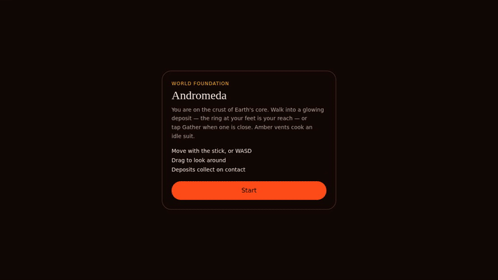

# Andromeda

World Foundation. A third-person walk across the crust of Earth's molten core. Gather crystals, ore, and embers before the vents cook your suit.

## See it run

Recorded from the live game: the start card, a walk across the crust, and two crystals picked up on contact.



Full clip: [docs/gameplay.mp4](docs/gameplay.mp4) (13 seconds, 1280×720).

## Play

Requires Node.js 22 or newer.

```bash
npm install
npm run dev
```

Open [http://127.0.0.1:8080](http://127.0.0.1:8080). Tap **Start**, then walk.

Phone and desktop use the same screen. On a phone, keep the browser in portrait and allow motion if the page asks.

## Controls

| Action | Phone | Desktop | Gamepad |
| --- | --- | --- | --- |
| Move | Left joystick | WASD or arrow keys | Left stick |
| Look | Drag anywhere that is not a button | Drag the view | — |
| Gather | **Gather** button | E or Space | Face button (button 0) |
| Retry | **Retry** | **Retry** | — |

Movement follows the camera. Drag to turn, then push the stick or W to walk that way.

## Goal

Collect **10** deposits. Walking into the ring at your feet picks one up. **Gather** reaches a little farther if a glow is close but not under you. Height does not matter — only ground distance.

The compass points at the nearest remaining deposit. Crystal, ore, and ember all count the same. Extra deposits stay on the crust after the goal.

Amber vents drain the suit. Standing clear restores it. If the suit hits zero, you respawn on the pad and the deposits you already took stay collected.

## Checks

```bash
npm run typecheck
npm test
node --experimental-strip-types --test src/game/world/sim.test.ts src/game/maps/earth-core.test.ts src/game/paths/paths.test.ts src/game/state/simulation.test.ts
```

`npm test` covers the app shell. The second command covers movement, gather range, the crust layout, and the older path simulation.

## Build

```bash
npm run build
npm run preview
```
